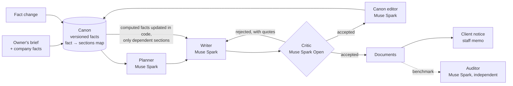

# PsycheEngine

A small warehouse runs on paperwork: an operations manual, a health and safety instruction, job descriptions, a service agreement with clients. Different people write them at different times, and they drift apart. One says the warehouse manager approves new forklift operators, another says the shift supervisor does. The client agreement promises quarantine in Zone E while the manual sends damaged goods to Zone F. Then the speed limit changes and somebody has to find every page that mentions it.

PsycheEngine writes all of these documents from one shared canon of company facts and keeps them consistent, both when they are first written and every time a fact changes. It runs on Muse Spark and was built for the Meta Global AI Developer Hackathon 2026.

I worked as a warehouse operative before this. The contradictions above are the kind I used to find on real notice boards. The company in this repository, Harborwick 3PL, is made up.

## What it does

The canon is a versioned list of facts about the company: zones, limits, roles, approvals, procedure numbers, the order of steps. Each fact has an id and a list of the sections that rely on it. Four documents are written from it (operations manual, H&S instruction, job descriptions, client SLA), 65 sections in total.

A critic checks every section against the canon before it is accepted. If it finds a conflict it quotes the offending words, and the writer revises the section until it passes.

The canon grows while the documents are being written. When a section commits to something the canon did not settle yet, say where packing happens or who signs off a recount, the canon editor records it, and every later section in every document has to agree with it.

Some facts are computed. Pallets per trailer, outbound capacity per shift and hazmat cage capacity are formulas over other facts, evaluated in code rather than by the model. Lower the maximum pallet weight and those numbers move on their own, the way a spreadsheet would.

When a fact changes, the fact-to-sections map says exactly which sections to revise, and each revision goes back through the critic. After that PsycheEngine drafts a notice for clients (pointing to the SLA) and a memo for staff (pointing to the manual and the H&S instruction). The critic checks those too.

## Results

The numbers below come from real runs. An independent auditor scores every version with the same prompts (Muse Spark 1.3 at high reasoning, separate from the engine's agents). It has to quote both passages of a contradiction word for word, or the report is thrown away. Before trusting it, I planted 10 contradictions in a finished manual by hand. It found all 10.

### Writing four documents (65 sections)

| | contradictions within a document | contradictions between documents | violations of company facts | cost |
|---|---|---|---|---|
| PsycheEngine | 0 | **0** | 0 | $2.33 |
| Muse Spark, each document in its own session | 1 | **5** | 1 | $0.63 |
| Muse Spark, all earlier documents in one long context | 0 | 0 | 3 | $1.05 |

These are single runs (md-v2). An earlier run (md-v1) showed the same split, 0 versus 5 between documents. Repeat runs are in progress and this table will report ranges.

Two things surprised me on the way here.

A single long manual is not where Muse Spark fails. With a 1M-token context it wrote a consistent 60-page manual with or without PsycheEngine (0 to 2 contradictions either way). I measured that first and changed the focus of the project because of it.

Putting every document into one prompt also works, once. The long-context baseline matched PsycheEngine on cross-document contradictions. The difference shows up over time, when documents are written months apart and facts change.

### Five changes in a row

The owner announces five changes, one after another: a lower maximum pallet weight, a lower indoor speed limit, a lighter trailer fleet, a new write-off threshold, more loads per dock door. Three of them move computed values. PsycheEngine applies each change through the canon. The baseline gets the owner's notice together with all current documents in one long-context request per change, and returns the sections it decides to update.

| after change | PsycheEngine: sections rewritten / stale values | baseline: sections rewritten / stale values |
|---|---|---|
| 1. pallet max 1000 → 800 kg (3 computed values follow) | 18 / 0 | 41 / 1 |
| 2. indoor speed 10 → 8 km/h | 12 / 0 | 38 / 1 |
| 3. trailer payload 24 → 22 t (2 computed values follow) | 5 / 0 | 4 / 1 |
| 4. write-off threshold 500 → 750 EUR | 10 / 0 | 15 / 2 |
| 5. loads per door 3 → 4 (1 computed value follows) | 4 / 0 | 4 / 2 |
| final audit: contradictions / fact violations | 1 / 0 | 1 / 4 |
| cost of the five changes | $1.58 | $0.75 |

A stale value is any earlier value of a changed fact, computed ones included, still written with its unit. A plain regex scan finds them, no model involved. The baseline kept "1,000 kg" from the first change to the end. After the fourth change one of its sections said write-offs above 500 EUR need the manager, and the next one said 750 EUR.

Some caveats. The baseline's results swing a lot between runs: an earlier mutation run ended with 26 fact violations, this one with 4. PsycheEngine costs about twice as much. And the benchmark caught a bug of ours before it caught anything else. Two approval rules quoted the write-off amount in their wording, the canon didn't know that, and they stayed at 500 EUR. Facts can now reference other facts, so a rule that quotes a value changes with it. I re-ran the benchmark from a clean copy after the fix.

## How it works



| agent | model | job |
|---|---|---|
| Planner | Muse Spark 1.3 via Meta Model API | table of contents per document and the facts each section needs |
| Writer | Muse Spark 1.3 | writes or revises one section from the canon |
| Critic | Muse Spark Open (open weights, Modal shared endpoint) | checks a section or notice against the canon and quotes every conflict |
| Canon editor | Muse Spark 1.3 | records new checkable facts from accepted sections |
| Auditor, benchmark only | Muse Spark 1.3, high reasoning | independent counts of contradictions and fact violations |

A few details I care about:

- Every model call goes through one OpenAI-compatible client with strict JSON schemas. It logs tokens and cost per call, retries dropped connections and stops at a budget cap, because Meta's spend limit only sends an email.
- A critic issue has to quote the section verbatim. If the quote isn't in the text, the issue is treated as a hallucination and dropped.
- Values the critic rejected never reach the canon. A section still failing after three attempts is not passed to the canon editor.
- Computed facts run through a small whitelisted arithmetic interpreter (numbers, + − × ÷, min, max, floor, ceil). There is no `eval`.
- The canon sits at the start of every prompt as a stable prefix, so Meta's prompt cache applies. About 80% of the canon editor's input is served from cache.
- Runs can resume after a dropped connection, and every canon version stays on disk.

The prompts are plain Markdown in [`engine/psyche/prompts/`](engine/psyche/prompts/), the baseline and auditor prompts included, so anyone can repeat the benchmark.

## Dashboard

`web/` is a Next.js dashboard that reads the run files directly and never calls a model while you look at it. It shows the canon with a version slider, the four documents side by side for PsycheEngine and the baseline with contradictions linked to the passage they conflict with, a document-by-document contradiction matrix, cost per document and the agent log. You can replay a fact change: the dependency graph, the rewrite log, a before/after diff and the two notices. A separate tab covers the five-change benchmark.

## Run it

```bash
python -m venv engine/.venv
engine/.venv/Scripts/python -m pip install -e "engine[dev]"     # macOS/Linux: engine/.venv/bin/python
cp .env.example .env                                             # MODEL_API_KEY; see the note below for the critic
engine/.venv/Scripts/python -m pytest engine                     # offline tests
engine/.venv/Scripts/python engine/scripts/smoke_test.py         # one real call per provider (< $0.01)

# write all four documents (about $2), then the baselines and the audit
engine/.venv/Scripts/python engine/scripts/generate.py --run demo
engine/.venv/Scripts/python engine/scripts/benchmark.py baseline --run demo --variant separate
engine/.venv/Scripts/python engine/scripts/benchmark.py baseline --run demo --variant shared
engine/.venv/Scripts/python engine/scripts/benchmark.py audit --run demo

# change one fact: rewrites dependent sections and drafts the notices
engine/.venv/Scripts/python engine/scripts/change_fact.py --run demo --fact F-LIM-01 --value 8 \
    --statement "Forklifts must not exceed 8 km/h inside the building."

# five stacked changes against the baseline (always on a fresh copy of a run)
engine/.venv/Scripts/python engine/scripts/mutate.py --run demo-copy --audit

# dashboard
engine/.venv/Scripts/python engine/scripts/export_web.py --run demo --label "my run"
cd web && npm install && npm run dev
```

The critic runs on Muse Spark 1.3 by default. The reported runs used Muse Spark Open: set `CRITIC_PROVIDER=open`, `OPEN_WEIGHTS_BASE_URL` and `OPEN_WEIGHTS_API_KEY` in `.env` to reproduce them.

The company lives in [`data/company/`](data/company/): `brief.md` is how the owner describes the site, `company.json` holds the facts (computed ones included), `documents.json` lists the documents to write and `mutations.json` the five changes.

## Where it could go

The same canon could guard the documents a warehouse produces every day. A goods dispatch note (WZ), a goods receipt (PZ), an internal transfer (MM) or a CMR consignment note has to agree with the SLA on cut-off times, dock doors, temperature ranges and load limits. With transaction data from a WMS, PsycheEngine could check those against the canon before they get printed. Nothing in the loop is specific to warehouses either. Production procedures or a quality manual have the same problem: long documents full of facts that have to agree.

## Built during the hackathon

Everything in this repository was written during the build period, 26 October to 4 November 2026. Daily progress is in [NOTES.md](NOTES.md) and in the commit history, and every feature went through a pull request and a code review.

The code was written with Claude Code and Muse Code; the dashboard was built with Muse Code. The documents, critiques, canon updates and notices come from Muse Spark 1.3 through the Meta Model API and from Muse Spark Open on a Modal shared endpoint.
