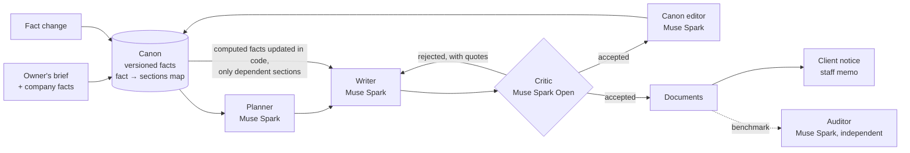

# PsycheEngine

A small warehouse runs on paperwork: an operations manual, a health and safety instruction, job descriptions, a service agreement with clients. Different people write them at different times, and they drift apart. One says the warehouse manager approves new forklift operators, another says the shift supervisor does. The client agreement promises quarantine in Zone E while the manual sends damaged goods to Zone F. Then the speed limit changes and somebody has to find every page that mentions it.

PsycheEngine writes all of these documents from one shared canon of company facts and keeps them consistent, both when they are first written and every time a fact changes. It runs on Muse Spark and was built for the Meta Global AI Developer Hackathon 2026.

I worked as a warehouse operative before this. The contradictions above are the kind I used to find on real notice boards. The company in this repository, Harborwick 3PL, is made up.

## What it does

The canon is a versioned list of facts about the company: zones, limits, roles, approvals, procedure numbers, the order of steps. Each fact has an id and a list of the sections that rely on it. Four documents are written from it (operations manual, H&S instruction, job descriptions, client SLA), 65 sections in total.

A critic checks every section against the canon before it is accepted. If it finds a conflict it quotes the offending words, and the writer revises the section until it passes.

The canon grows while the documents are being written. When a section commits to something the canon did not settle yet, say where packing happens or who signs off a recount, the canon editor records it, and every later section in every document has to agree with it.

Some facts are computed. Pallets per trailer, outbound capacity per shift and hazmat cage capacity are formulas over other facts, evaluated in code rather than by the model. Lower the maximum pallet weight and those numbers move on their own, the way a spreadsheet would.

When a fact changes, the fact-to-sections map says exactly which sections to revise, and each revision goes back through the critic. After that PsycheEngine drafts a notice for clients (pointing to the SLA) and a memo for staff (pointing to the manual and the H&S instruction). The critic checks those too.

## Results

The numbers below come from real runs in `runs/`. An independent auditor scores every version with the same prompts (Muse Spark 1.3 at high reasoning, separate from the engine's agents). It has to quote both passages of a contradiction word for word, or the report is thrown away. Before trusting it, I planted 10 contradictions in a finished manual by hand. It found all 10.

### A year of changes

This is the test that matters most to me, because it is how documentation actually goes wrong. The four documents are written once, then the owner announces twelve changes over a year, one per month: a lower pallet weight cap (twice), a lower indoor speed limit, a colder cold zone, a new write-off threshold, more loads per dock door, a lower yard speed, a smaller hazmat limit, a lower stacking height, a fifth outbound door, stronger racking. In May the whole fleet is replaced: seven facts change at once (forklift and reach-truck counts and ratings, pallet jacks, the van and the trailers), and the computed capacities move with them.

PsycheEngine applies each change through the canon. It is compared with two baselines on the same model. In the first, Muse Spark gets every current document plus the owner's notice in one long-context request and returns the sections it decides to update. In the second, each document is updated on its own, the way its owner would do it.

Out-of-date values left in the documents after each month (run md-v4y):

| month | PsycheEngine | baseline, one context | baseline, each document separately |
|---|---|---|---|
| Jan–Mar | 0 | 0 | 0 |
| Apr: write-off threshold | 0 | 5 | 1 |
| **May: fleet modernisation (7 facts)** | **0** | **11** | **4** |
| Jun–Sep | 0 | 11–12 | 4 |
| Oct: pallet cap 900 → 800 kg | 0 | 13 | 4 |
| Nov: fifth outbound door | 0 | 13 | 4 |
| **Dec: racking upgrade** | **0** | **14** | **4** |
| sections rewritten over the year | 108 | 328 | 352 |
| cost of the year | $3.29 | $2.18 | $2.49 |

An out-of-date value is any earlier value of a changed fact, computed ones included, still written with its unit somewhere in the documents. A plain regex scan finds them, no model involved. Values that another fact still holds (the stacking height used to be 4.0 m, and so are the main aisles) are left out, because text alone cannot tell them apart. The scan errs on the side of missing things: an earlier, looser version also read "doors 1-4 inbound and doors 5-9" as four doors, and I re-scored every run with the stricter one (`engine/scripts/rescore.py`), which lowered the baselines' counts, never PsycheEngine's.

Neither baseline repairs what it missed: an old value that survives one month is still there in December. PsycheEngine rewrites a third as many sections, which is what someone has to re-read and sign off before the next audit.

The final audit agrees once one flaw of mine is set aside. My November change added a fifth outbound door but did not update the facts that number the doors ("8 doors", "doors 5–8"), so the auditor counted "doors 5–9" as a violation even though it is the sensible reading. Leaving those door-numbering facts out, the final fact violations are 0 for PsycheEngine, 11 for the one-context baseline and 3 for the per-document one (with them: 2, 68 and 74). I kept the input file as it was run so the numbers can be reproduced.

### The same five changes, three runs

A shorter scenario (five changes, three of them moving computed values) repeated on three independently written sets of documents (md-v2h, md-v3h, md-v4h), against the one-context baseline:

| | out-of-date values after the 5th change | final audit: contradictions / fact violations | sections rewritten | cost |
|---|---|---|---|---|
| PsycheEngine | 0 / 0 / 0 (0 after every step) | 0/0 · 0/0 · 1/0 | 49 / 40 / 43 | $1.82 / $1.32 / $1.25 |
| baseline | 2 / 4 / 3 | 1/2 · 2/6 · 3/6 | 102 / 103 / 115 | $0.75 / $0.72 / $0.83 |

On Meta's contributor tier (same model, cheaper, Meta may train on the prompts) the writer's share of these five changes fell from about $1 to $0.05 with the same result (0 out-of-date values); the open-weights critic on Modal is then most of the cost, about $0.12 per change.

### Writing four documents

| | contradictions between documents | contradictions within a document | violations of company facts |
|---|---|---|---|
| PsycheEngine | **0 / 0 / 1** | 0 / 0 / 0 | 0 / 0 / 0 |
| Muse Spark, each document in its own session | **5 / 3 / 3** | 1 / 0 / 1 | 1 / 2 / 1 |
| Muse Spark, all earlier documents in one long context | 0 / 0 / 1 | 0 / 0 / 0 | 3 / 2 / 0 |

Three runs (md-v2, md-v3, md-v4), 65–69 sections each. Writing them cost about $2.3 with PsycheEngine, $0.6 for separate sessions and $1.0 for one long context.

### What surprised me, and what the benchmark caught in my own code

A single long manual is not where Muse Spark fails. With a 1M-token context it wrote a consistent 60-page manual with or without PsycheEngine (0 to 2 contradictions either way). I measured that first and changed the focus of the project because of it. Putting every document into one prompt also works, once. The difference shows up when documents are written separately and when facts change.

The benchmark also found four bugs in PsycheEngine before I could claim anything:

- Two approval rules quoted the write-off amount in their wording and kept "500 EUR" after the threshold changed. Facts can now reference the facts they quote.
- A revised section kept "never split a 1000 kg pallet" and the critic let it through. The engine now scans every revision for old values in code and sends it back, and as a last resort substitutes the value itself.
- Old values came back after being fixed, because the canon editor had recorded facts like "check the load against 24000 kg" without a link to the base fact. Such facts are now linked automatically.
- In the first attempt at the year run, that last-resort substitution rewrote "4.0 m wide main aisles" to 3.5 m when the stacking height changed. Values another fact still holds are now never touched. I threw that run away (it is kept as `runs/md-v4y-broken`) and re-ran the year from a clean copy.

PsycheEngine costs about 1.4 to 2.4 times as much as the baselines on the standard tier. A change costs roughly $0.10 to $0.40 depending on how many sections depend on it.

## How it works



| agent | model | job |
|---|---|---|
| Planner | Muse Spark 1.3 via Meta Model API | table of contents per document and the facts each section needs |
| Writer | Muse Spark 1.3 | writes or revises one section from the canon |
| Critic | Muse Spark Open (open weights, Modal shared endpoint) | checks a section or notice against the canon and quotes every conflict |
| Canon editor | Muse Spark 1.3 | records new checkable facts from accepted sections |
| Auditor, benchmark only | Muse Spark 1.3, high reasoning | independent counts of contradictions and fact violations |

A few details I care about:

- Every model call goes through one OpenAI-compatible client with strict JSON schemas. It logs tokens and cost per call, retries dropped connections and stops at a budget cap, because Meta's spend limit only sends an email.
- A critic issue has to quote the section verbatim. If the quote isn't in the text, the issue is treated as a hallucination and dropped.
- Values the critic rejected never reach the canon. A section still failing after three attempts is not passed to the canon editor.
- Computed facts run through a small whitelisted arithmetic interpreter (numbers, + − × ÷, min, max, floor, ceil). There is no `eval`.
- The canon sits at the start of every prompt as a stable prefix, so Meta's prompt cache applies. About 80% of the canon editor's input is served from cache.
- Runs can resume after a dropped connection, and every canon version stays on disk.

The prompts are plain Markdown in [`engine/psyche/prompts/`](engine/psyche/prompts/), the baseline and auditor prompts included, so anyone can repeat the benchmark.

## Dashboard

`web/` is a Next.js dashboard that reads the run files directly and never calls a model while you look at it. It shows the canon with a version slider, the four documents side by side for PsycheEngine and the baseline with contradictions linked to the passage they conflict with, a document-by-document contradiction matrix, cost per document and the agent log. You can replay a fact change: the dependency graph, the rewrite log, a before/after diff and the two notices. A separate view replays the year of changes month by month.

## Run it

```bash
python -m venv engine/.venv
engine/.venv/Scripts/python -m pip install -e "engine[dev]"     # macOS/Linux: engine/.venv/bin/python
cp .env.example .env                                             # MODEL_API_KEY; see the note below for the critic
engine/.venv/Scripts/python -m pytest engine                     # offline tests
engine/.venv/Scripts/python engine/scripts/smoke_test.py         # one real call per provider (< $0.01)

# write all four documents (about $2), then the baselines and the audit
engine/.venv/Scripts/python engine/scripts/generate.py --run demo
engine/.venv/Scripts/python engine/scripts/benchmark.py baseline --run demo --variant separate
engine/.venv/Scripts/python engine/scripts/benchmark.py baseline --run demo --variant shared
engine/.venv/Scripts/python engine/scripts/benchmark.py audit --run demo

# change one fact: rewrites dependent sections and drafts the notices
engine/.venv/Scripts/python engine/scripts/change_fact.py --run demo --fact F-LIM-01 --value 8 \
    --statement "Forklifts must not exceed 8 km/h inside the building."

# a year of changes against both baselines (always on a fresh copy of a run)
engine/.venv/Scripts/python engine/scripts/mutate.py --run demo-copy --mutations data/company/mutations_year.json \
    --baseline shared --per-doc-baseline separate --audit

# dashboard
engine/.venv/Scripts/python engine/scripts/export_web.py --run demo --label "my run"
cd web && npm install && npm run dev
```

The critic runs on Muse Spark 1.3 by default. The reported runs used Muse Spark Open: set `CRITIC_PROVIDER=open`, `OPEN_WEIGHTS_BASE_URL` and `OPEN_WEIGHTS_API_KEY` in `.env` to reproduce them.

The company lives in [`data/company/`](data/company/): `brief.md` is how the owner describes the site, `company.json` holds the facts (computed ones included), `documents.json` lists the documents to write and `mutations.json` and `mutations_year.json` the two change scenarios.

## Where it could go

The same canon could guard the documents a warehouse produces every day. A goods dispatch note (WZ), a goods receipt (PZ), an internal transfer (MM) or a CMR consignment note has to agree with the SLA on cut-off times, dock doors, temperature ranges and load limits. With transaction data from a WMS, PsycheEngine could check those against the canon before they get printed. Nothing in the loop is specific to warehouses either. Production procedures or a quality manual have the same problem: long documents full of facts that have to agree.

## Built during the hackathon

Everything in this repository was written during the build period, 26 October to 4 November 2026. Daily progress is in [NOTES.md](NOTES.md) and in the commit history, and every feature went through a pull request and a code review.

The code was written with Claude Code and Muse Code; the dashboard was built with Muse Code. The documents, critiques, canon updates and notices come from Muse Spark 1.3 through the Meta Model API and from Muse Spark Open on a Modal shared endpoint.
